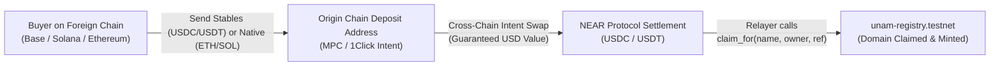

# Universal Name (.uni) — Multichain Payment & Supported Stablecoins Guide

This document details the payment architecture, supported stablecoins across all blockchains, and the cross-chain intent settlement model for **Universal Name** (`.uni`).

---

## 1. Core Architecture: Intent Routing to NEAR Stablecoins

The Universal Name registry contract lives on **NEAR Protocol** (`unam-registry.testnet`), serving as the single canonical source of truth for name ownership and multichain records.

### The "Accept Anything, Settle on NEAR" Principle
1. **Target Settlement Asset:**
   All domain registrations are priced in USD and settle on NEAR in verified, standard 6-decimal stablecoins:
   - **Primary Native/Bridged Stablecoin:** USDC (`17208628f84f5d6ad33f0da3bbbeb27ffcb398eac501a31bd6ad2011e3613760` on testnet / `17208628f84f5d6ad33f0da3bbbeb27ffcb398eac501a31bd6ad2011e3613760` on mainnet)
   - **Multi-Token Acceptance:** USDT (`usdt.fakes.testnet` / `dac17f958d2ee523a2206206994597c13d831ec7`), omft assets, and admin-approved NEP-141 tokens.
2. **Accept Anything from Any Chain:**
   Buyers do **not** need to hold NEAR or NEAR-native USDC. Senders can pay using:
   - **Stablecoins (1:1 Settlement):** USDC, USDT, DAI across Ethereum, Base, Arbitrum, Solana, Polygon, Optimism, BSC, Avalanche.
   - **Native & Volatile Tokens (Intent Swap Settlement):** ETH, SOL, BTC, NEAR, POL, BNB, AVAX.
3. **Intent-Driven Cross-Chain Execution:**
   - The user requests a checkout session specifying their source chain (e.g. Base) and payment token (e.g. USDC or ETH).
   - An MPC deposit address (via NEAR Chain Signatures) or 1Click Intent address is generated on that origin chain.
   - When the user sends funds, the Intent Router fills the order via auction, converts the asset into the required exact stablecoin amount, and routes it to NEAR.
   - Upon settlement on NEAR, the authorized relayer executes `claim_for(name, owner, payment_ref)` on `unam-registry.testnet`.



---

## 2. Length-Tiered Pricing Model

Universal Name enforces length-tiered pricing in 6-decimal micro-units ($1.00 USD = `1_000_000` units):

| Domain Length | Registration Fee | Micro-Units (6 Decimals) | Notes |
| :--- | :--- | :--- | :--- |
| **3 characters** (e.g. `cat.uni`, `pen.uni`) | **$50.00** | `50_000_000` | Premium short identifier |
| **4 characters** (e.g. `moon.uni`, `peni.uni`) | **$20.00** | `20_000_000` | High-demand 4-letter names |
| **5+ characters** (e.g. `alice.uni`, `stellar.uni`) | **$5.00** | `5_000_000` | Standard public tier |

---

## 3. Supported Stablecoins by Blockchain

The following table lists the first-class stablecoins supported across all target networks:

| Blockchain | CAIP-2 Chain ID | Symbol | Asset Name | Decimals | Contract Address |
| :--- | :--- | :--- | :--- | :---: | :--- |
| **Ethereum** | `eip155:1` | **USDC** | USD Coin | 6 | `0xa0b86991c6218b36c1d19d4a2e9eb0ce3606eb48` |
| | | **USDT** | Tether USD | 6 | `0xdac17f958d2ee523a2206206994597c13d831ec7` |
| | | **DAI** | Dai Stablecoin | 18 | `0x6b175474e89094c44da98b954eedeac495271d0f` |
| **Base** | `eip155:8453` | **USDC** | USD Coin | 6 | `0x833589fcd6edb6e08f4c7c32d4f71b54bda02913` |
| **Arbitrum One** | `eip155:42161` | **USDC** | USD Coin | 6 | `0xaf88d065e77c8cc2239327c5edb3a432268e5831` |
| | | **USDT** | Tether USD | 6 | `0xfd086bc7cd5c481dcc9c85ebe478a1c0b69fcbb9` |
| | | **DAI** | Dai Stablecoin | 18 | `0xda10009cbd5d07dd0cecc66161fc93d7c9000da1` |
| **Optimism** | `eip155:10` | **USDC** | USD Coin | 6 | `0x0b2c639c533813f4aa9d7837caf62653d097ff85` |
| | | **USDT** | Tether USD | 6 | `0x94b008aa00579c1307b0ef2c499ad98a8ce58e58` |
| **Polygon** | `eip155:137` | **USDC** | USD Coin | 6 | `0x3c499c542cef5e3811e1192ce70d8cc03d5c3359` |
| | | **USDT** | Tether USD | 6 | `0xc2132d05d31c914a87c6611c10748aeb04b58e8f` |
| | | **DAI** | Dai Stablecoin | 18 | `0x8f3cf7ad23cd3cadbd9735aff958023239c6a063` |
| **BNB Chain** | `eip155:56` | **USDT** | Tether USD | 18 | `0x55d398326f99059ff775485246999027b3197955` |
| | | **USDC** | USD Coin | 18 | `0x8ac76a51cc950d9822d68b83fe1ad97b32cd580d` |
| **Avalanche** | `eip155:43114` | **USDC** | USD Coin | 6 | `0xb97ef9ef8734c71904d8002f8b6bc66dd9c48a6e` |
| | | **USDT** | Tether USD | 6 | `0x9702230a8ea53601f5cd2dc00fdbc13d4df4a8c7` |
| **Solana** | `solana:...` | **USDC** | USD Coin | 6 | `EPjFWdd5AufqSSqeM2qN1xzybapC8G4wEGGkZwyTDt1v` |
| | | **USDT** | Tether USD | 6 | `Es9vMFrzaCERmJfrF4H2FYD4KCoNkY11McCe8BenwNYB` |
| **NEAR Testnet** | `near:testnet` | **USDC** | USD Coin | 6 | `17208628f84f5d6ad33f0da3bbbeb27ffcb398eac501a31bd6ad2011e3613760` |
| | | **USDT** | Tether USD | 6 | `usdt.fakes.testnet` |
| **NEAR Mainnet** | `near:mainnet` | **USDC** | USD Coin | 6 | `17208628f84f5d6ad33f0da3bbbeb27ffcb398eac501a31bd6ad2011e3613760` |
| | | **USDT** | Tether USD | 6 | `dac17f958d2ee523a2206206994597c13d831ec7` |

---

## 4. Intent-Routable Cross-Chain Assets

In addition to stablecoins, buyers can select native and volatile assets. The Intent Router calculates the required quantity in real-time, guarantees the swap value, and delivers the exact stablecoin amount to NEAR:

| Blockchain | Symbol | Asset Name | Decimals | Route Mechanism |
| :--- | :--- | :--- | :---: | :--- |
| **Ethereum** | `ETH` | Ether (Native) | 18 | 1Click / Defuse swap to NEAR USDC |
| **Base** | `ETH` | Ether (Native) | 18 | 1Click / Defuse swap to NEAR USDC |
| **Arbitrum One** | `ETH` | Ether (Native) | 18 | 1Click / Defuse swap to NEAR USDC |
| **Optimism** | `ETH` | Ether (Native) | 18 | 1Click / Defuse swap to NEAR USDC |
| **Polygon** | `POL` | Polygon Token | 18 | 1Click / Defuse swap to NEAR USDC |
| **BNB Chain** | `BNB` | BNB (Native) | 18 | 1Click / Defuse swap to NEAR USDC |
| **Avalanche** | `AVAX` | Avalanche (Native) | 18 | 1Click / Defuse swap to NEAR USDC |
| **Solana** | `SOL` | Solana (Native) | 9 | 1Click / Defuse swap to NEAR USDC |
| **NEAR Protocol** | `NEAR` | NEAR (Native / wNEAR) | 24 | Ref Finance / Intent swap to NEAR USDC |

---

## 5. Checkout & Payment API Endpoints

### 1. Check Pricing and Name Availability
```http
GET /v1/checkout/pricing?name=stellar.uni
```
**Response:**
```json
{
  "name": "stellar.uni",
  "label": "stellar",
  "length": 7,
  "available": true,
  "priceUsd": 5.0,
  "priceMicroUnits": "5000000",
  "settlementAsset": "USDC on NEAR Protocol (nep141:17208628f84f5d6ad33f0da3bbbeb27ffcb398eac501a31bd6ad2011e3613760)",
  "supportedChains": [...]
}
```

### 2. Create Multichain Checkout Session
```http
POST /v1/checkout/session
Content-Type: application/json

{
  "name": "stellar.uni",
  "owner": "alice.testnet",
  "chain": "base",
  "token": "USDC",
  "refund_to": "0x71C7656EC7ab88b098defB751B7401B5f6d8976F"
}
```
**Response:**
```json
{
  "checkoutId": "chk_8a129d4c72ef1a0b",
  "name": "stellar.uni",
  "owner": "alice.testnet",
  "chain": "eip155:8453",
  "chainName": "Base",
  "token": "USDC",
  "isStable": true,
  "settlementType": "DIRECT_STABLECOIN",
  "settlementAsset": "USDC (NEAR Protocol)",
  "priceUsd": 5.0,
  "amount": "5000000",
  "amountFormatted": "5.00 USDC",
  "depositAddress": "0x71C7656EC7ab88b098defB751B7401B5f6d8976F",
  "status": "PENDING_PAYMENT",
  "instructions": "Send exactly 5.00 USDC to 0x... on Base. Domain stellar.uni will be claimed automatically for alice.testnet upon receipt."
}
```

### 3. Settle Payment & Claim Domain
```http
POST /v1/checkout/submit
Content-Type: application/json

{
  "checkout_id": "chk_8a129d4c72ef1a0b",
  "tx_hash": "0x9876543210abcdef..."
}
```
**Response:**
```json
{
  "checkoutId": "chk_8a129d4c72ef1a0b",
  "status": "COMPLETED",
  "name": "stellar.uni",
  "owner": "alice.testnet",
  "nearTxHash": "22gbS7rxeJM2Rq8wmQXeq7gMgwAtuALJccwWPqUjDfj4",
  "completedAt": 1794500000
}
```

---

## 6. Smart Contract Write Methods on NEAR

For buyers paying directly from a NEAR account:

### A. Direct NEP-141 Payment (`ft_transfer_call`)
```bash
near contract call-function as-transaction 17208628f84f5d6ad33f0da3bbbeb27ffcb398eac501a31bd6ad2011e3613760 \
  ft_transfer_call \
  json-args '{
    "receiver_id": "unam-registry.testnet",
    "amount": "5000000",
    "msg": "{\"name\":\"alice.uni\"}"
  }' \
  prepaid-gas '100.0 Tgas' attached-deposit '1 yoctoNEAR' \
  sign-as alice.testnet network-config testnet sign-with-keychain send
```
- Insufficient amounts are immediately refunded in full.
- Overpayments automatically refund the difference.

### B. Relayer Settlement (`claim_for`)
Authorized relayer (`shedasolution.testnet` or admin) executes:
```bash
near contract call-function as-transaction unam-registry.testnet \
  claim_for \
  json-args '{
    "name": "reach.uni",
    "owner": "reach.testnet",
    "payment_ref": "intent:base:usdc:0x987654321"
  }' \
  prepaid-gas '100.0 Tgas' attached-deposit '0 NEAR' \
  sign-as shedasolution.testnet network-config testnet sign-with-keychain send
```
Emits standard NEP-297 event `PaymentProcessed { name, payer, amount, payment_ref }`.
