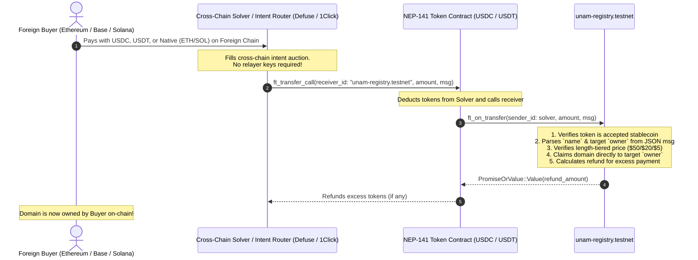

# Universal Name (.uni) — Multichain Payment, Keyless Callback Abstraction & Supported Stablecoins Guide

This document details the payment architecture, the **keyless callback cross-chain abstraction model**, supported stablecoins across all blockchains, and the on-chain registry state for **Universal Name** (`.uni`).

---

## 1. Keyless Cross-Chain Abstraction: Why We Don't Manage Keys

### The Problem with Traditional Relayers
In conventional cross-chain setups, payment settlement requires an off-chain server running a relayer daemon:
- **Custody & Attack Surface:** The server holds a hot private key with elevated privileges (e.g. calling `claim_for(name, owner, ref)`). If compromised, an attacker can register arbitrary names or disrupt operations.
- **Gas Exhaustion:** The relayer hot wallet must constantly hold native NEAR to pay for gas. When funds deplete, user registrations halt.
- **Centralized Single Point of Failure:** If the relayer server crashes, restarts, or loses network connectivity, foreign-chain buyers get stuck waiting for domain minting.

### The Solution: Native NEP-141 Callback Abstraction
Universal Name eliminates relayer key management entirely by leveraging the native NEAR token standard:
**`ft_transfer_call(receiver_id, amount, msg)` &rarr; `ft_on_transfer(sender_id, amount, msg)`**.



### Typed `msg` Deserialization & Enum Specification
To guarantee type safety and clear developer ergonomics, the contract deserializes `msg` into a strongly typed enum holding structured arguments:

```rust
#[near(serializers = [json])]
#[derive(Clone, Debug, PartialEq)]
pub struct ClaimArgs {
    pub name: String,
    pub owner: Option<AccountId>,
}

#[near(serializers = [json])]
#[derive(Clone, Debug, PartialEq)]
#[serde(rename_all = "snake_case")]
pub enum FtTransferAction {
    Claim(ClaimArgs),
    Register(ClaimArgs),
}

#[near(serializers = [json])]
#[derive(Clone, Debug, PartialEq)]
#[serde(untagged)]
pub enum FtOnTransferMsg {
    Action(FtTransferAction),
    Direct(ClaimArgs),
    Plain(String),
}
```

#### Supported `msg` Formats:
1. **Tagged Action Format (Recommended for Solvers & Adapters):**
   ```json
   {
     "claim": {
       "name": "alice.uni",
       "owner": "alice.testnet"
     }
   }
   ```
   Or with `"register"`:
   ```json
   {
     "register": {
       "name": "alice.uni",
       "owner": "alice.testnet"
     }
   }
   ```
2. **Direct Struct Format (Untagged):**
   ```json
   {
     "name": "alice.uni",
     "owner": "alice.testnet"
   }
   ```
3. **Self-Registration Format (Defaults owner to `sender_id`):**
   ```json
   {
     "name": "alice.uni"
   }
   ```
4. **Plain Name String:**
   `"alice.uni"`

#### Field Reference:
- **`name`** *(string, required)*: The Universal Name being claimed (e.g. `alice.uni` or `alice`).
- **`owner`** *(string, optional)*: The NEAR Account ID of the target buyer who will own the domain. If omitted, ownership defaults to `sender_id` (the caller/solver).
- **Price Verification & Atomic Refund:**
  - If `amount < price_for_name(name)`: The contract refuses the claim and immediately returns `amount` in full as a refund to `sender_id`.
  - If `amount >= price_for_name(name)`: The contract claims the domain directly to `owner`, emits a standard NEP-297 `NameClaimed` event and `PaymentProcessed` event, and returns `amount - price` back to `sender_id`.
- **Zero Server Keys:** The registry contract autonomously executes the registration on-chain during the callback. No off-chain private keys are needed!

---

## 2. Relayer & Administrative Configuration

The on-chain contract at `unam-registry.testnet` maintains explicit governance roles:

| Role | Configured Account | Purpose |
| :--- | :--- | :--- |
| **Relayer** | `unam-registry.testnet` | Configured as the contract itself. Eliminates external third-party relayer dependencies. |
| **Admin** | `unam-registry.testnet` | Master administrator account for configuration, accepted payment tokens, and rapid policy approvals. |

### Role of `claim_for(name, owner, payment_ref)`
While the primary user flow uses the **keyless callback abstraction** above, `claim_for` remains available in the contract for administrative interventions or contract-to-contract settlements. It is strictly guarded:
```rust
let is_privileged = caller == self.admin || Some(&caller) == self.relayer.as_ref();
require!(is_privileged, "NOT_AUTHORIZED");
```
Because `relayer` is set to `unam-registry.testnet`, external untrusted accounts cannot invoke `claim_for`.

### Admin Bypass for Queued Policy Changes
To protect users from malicious destination changes, changes to a name's receive policy are queued for a time delay (default 24h). However, administrators can expedite or override queued changes:
- Method: `admin_approve_pending_policy(name)` (aliases: `admin_approve_pending_change`, `approve_pending_policy`).
- Accessible via the resolver endpoint: `POST /v1/admin/approve-policy`.
- Immediately applies the pending policy and clears the queue, emitting `PolicyChanged`.

---

## 3. Verified On-Chain State

The contract is deployed on **NEAR Testnet** at [`unam-registry.testnet`](https://explorer.testnet.near.org/accounts/unam-registry.testnet).

### Key Accounts & Ownership
- **`peni.uni`**:
  - **Owner:** `peni.testnet`
  - **Generation:** `3`
  - **Connected Chains:**
    - `eip155:1` (Ethereum) &rarr; `0x1111111111111111111111111111111111111111` (with cryptographic proof)
  - Verified on-chain via `get_name("peni.uni")`.
- **`reach.uni`**:
  - **Owner:** `reach.testnet`
  - **Generation:** `2`
  - Verified on-chain via `get_name("reach.uni")`.

### Active Pricing Configuration
Verified on-chain via `get_pricing_config()`:
```json
{
  "payment_token": "17208628f84f5d6ad33f0da3bbbeb27ffcb398eac501a31bd6ad2011e3613760",
  "accepted_tokens": [],
  "relayer": "unam-registry.testnet",
  "price_3_char": "50000000",
  "price_4_char": "20000000",
  "price_5_plus_char": "5000000"
}
```

---

## 4. Length-Tiered Pricing & Slippage Buffer Model

### A. Base Contract Registration Fees
Universal Name enforces length-tiered pricing in 6-decimal micro-units ($1.00 USD = `1_000_000` micro-units):

| Domain Length | Registration Fee | Micro-Units (6 Decimals) | Description |
| :--- | :--- | :--- | :--- |
| **3 characters** (e.g. `cat.uni`, `pen.uni`) | **$50.00** | `50_000_000` | Premium short domain |
| **4 characters** (e.g. `moon.uni`, `peni.uni`) | **$20.00** | `20_000_000` | High-demand 4-letter domain |
| **5+ characters** (e.g. `alice.uni`, `stellar.uni`) | **$5.00** | `5_000_000` | Standard public domain |

### B. Dynamic Slippage & Cross-Chain Buffer Policy
Because cross-chain bridges and decentralized exchanges incur minor execution variance and swap slippage, the checkout service bills a small upfront safety buffer on foreign routes to guarantee that the final settlement amount reaching `unam-registry.testnet` satisfies the contract's strict price invariant:

| Route Type | Asset Examples | Upfront Buffer | Rationale |
| :--- | :--- | :---: | :--- |
| **Direct NEAR Stables** | USDC, USDT on NEAR | **$0.00** | 1:1 direct settlement; 0% slippage or bridge fees. Exact nominal fee billed. |
| **Cross-Chain Stables** | USDC, USDT on Base / Ethereum / Solana | **$1.00** | Absorbs cross-chain bridge fees and solver gas execution margins. |
| **Volatile Intent Assets** | ETH, SOL, AVAX, BNB, POL | **$1.50** | Absorbs DEX swap slippage and real-time market price drift. |

> [!NOTE]
> **Surplus Refund Guarantee:** Any excess funds that reach `unam-registry.testnet` above the base domain price are **automatically refunded** back to the sender by the contract's NEP-141 callback (`refund = amount - price`). Contract invariants remain strictly guarded, preventing direct underpayment exploits.

---

## 5. Supported Stablecoins Across Blockchains

Universal Name accepts stablecoins across all major Layer-1 and Layer-2 blockchains. Solvers route and swap incoming assets into verified NEAR stablecoins:

| Blockchain | CAIP-2 Identifier | Symbol | Name | Decimals | Contract Address |
| :--- | :--- | :--- | :--- | :---: | :--- |
| **Ethereum** | `eip155:1` | **USDC** | USD Coin | 6 | `0xa0b86991c6218b36c1d19d4a2e9eb0ce3606eb48` |
| | | **USDT** | Tether USD | 6 | `0xdac17f958d2ee523a2206206994597c13d831ec7` |
| | | **DAI** | Dai Stablecoin | 18 | `0x6b175474e89094c44da98b954eedeac495271d0f` |
| **Base** | `eip155:8453` | **USDC** | USD Coin | 6 | `0x833589fcd6edb6e08f4c7c32d4f71b54bda02913` |
| **Arbitrum One** | `eip155:42161` | **USDC** | USD Coin | 6 | `0xaf88d065e77c8cc2239327c5edb3a432268e5831` |
| | | **USDT** | Tether USD | 6 | `0xfd086bc7cd5c481dcc9c85ebe478a1c0b69fcbb9` |
| | | **DAI** | Dai Stablecoin | 18 | `0xda10009cbd5d07dd0cecc66161fc93d7c9000da1` |
| **Optimism** | `eip155:10` | **USDC** | USD Coin | 6 | `0x0b2c639c533813f4aa9d7837caf62653d097ff85` |
| | | **USDT** | Tether USD | 6 | `0x94b008aa00579c1307b0ef2c499ad98a8ce58e58` |
| **Polygon** | `eip155:137` | **USDC** | USD Coin | 6 | `0x3c499c542cef5e3811e1192ce70d8cc03d5c3359` |
| | | **USDT** | Tether USD | 6 | `0xc2132d05d31c914a87c6611c10748aeb04b58e8f` |
| | | **DAI** | Dai Stablecoin | 18 | `0x8f3cf7ad23cd3cadbd9735aff958023239c6a063` |
| **BNB Chain** | `eip155:56` | **USDT** | Tether USD | 18 | `0x55d398326f99059ff775485246999027b3197955` |
| | | **USDC** | USD Coin | 18 | `0x8ac76a51cc950d9822d68b83fe1ad97b32cd580d` |
| **Avalanche** | `eip155:43114` | **USDC** | USD Coin | 6 | `0xb97ef9ef8734c71904d8002f8b6bc66dd9c48a6e` |
| | | **USDT** | Tether USD | 6 | `0x9702230a8ea53601f5cd2dc00fdbc13d4df4a8c7` |
| **Solana** | `solana:5eykt4UsFv8P8NJdTREpY1vzqKqZKvdpKuc147dw2N9d` | **USDC** | USD Coin | 6 | `EPjFWdd5AufqSSqeM2qN1xzybapC8G4wEGGkZwyTDt1v` |
| | | **USDT** | Tether USD | 6 | `Es9vMFrzaCERmJfrF4H2FYD4KCoNkY11McCe8BenwNYB` |
| **NEAR Testnet** | `near:testnet` | **USDC** | USD Coin | 6 | `17208628f84f5d6ad33f0da3bbbeb27ffcb398eac501a31bd6ad2011e3613760` |
| | | **USDT** | Tether USD | 6 | `usdt.fakes.testnet` |
| **NEAR Mainnet** | `near:mainnet` | **USDC** | USD Coin | 6 | `17208628f84f5d6ad33f0da3bbbeb27ffcb398eac501a31bd6ad2011e3613760` |
| | | **USDT** | Tether USD | 6 | `dac17f958d2ee523a2206206994597c13d831ec7` |

---

## 6. Intent-Routable Cross-Chain Assets

Buyers who do not hold stablecoins can pay in native or volatile tokens. The cross-chain intent router guarantees USD execution and swaps into NEAR USDC:

| Origin Chain | Symbol | Asset Name | Decimals | Intent Swap Route |
| :--- | :--- | :--- | :---: | :--- |
| **Ethereum** | `ETH` | Ether (Native) | 18 | 1Click / Defuse swap &rarr; NEAR USDC |
| **Base** | `ETH` | Ether (Native) | 18 | 1Click / Defuse swap &rarr; NEAR USDC |
| **Arbitrum One** | `ETH` | Ether (Native) | 18 | 1Click / Defuse swap &rarr; NEAR USDC |
| **Optimism** | `ETH` | Ether (Native) | 18 | 1Click / Defuse swap &rarr; NEAR USDC |
| **Polygon** | `POL` | Polygon Token | 18 | 1Click / Defuse swap &rarr; NEAR USDC |
| **BNB Chain** | `BNB` | BNB (Native) | 18 | 1Click / Defuse swap &rarr; NEAR USDC |
| **Avalanche** | `AVAX` | Avalanche (Native) | 18 | 1Click / Defuse swap &rarr; NEAR USDC |
| **Solana** | `SOL` | Solana (Native) | 9 | 1Click / Defuse swap &rarr; NEAR USDC |
| **NEAR Protocol** | `NEAR` | NEAR (Native / wNEAR) | 24 | Ref Finance / 1Click &rarr; NEAR USDC |

---

## 7. Direct Contract Invocation Examples

### Direct NEP-141 Callback Payment
Purchasing a domain directly on NEAR using USDC (`17208628f84f5d6ad33f0da3bbbeb27ffcb398eac501a31bd6ad2011e3613760`):

```bash
near contract call-function as-transaction \
  17208628f84f5d6ad33f0da3bbbeb27ffcb398eac501a31bd6ad2011e3613760 \
  ft_transfer_call \
  json-args '{
    "receiver_id": "unam-registry.testnet",
    "amount": "5000000",
    "msg": "{\"name\":\"alice.uni\",\"owner\":\"alice.testnet\"}"
  }' \
  prepaid-gas '100.0 Tgas' \
  attached-deposit '1 yoctoNEAR' \
  sign-as solver.testnet \
  network-config testnet \
  sign-with-keychain send
```

- If `msg` specifies `"owner": "alice.testnet"`, the domain is claimed directly to `alice.testnet`, while `solver.testnet` is credited as payer.
- Any overpayment is returned to `solver.testnet` via the NEP-141 return value.

### Admin Approval for Queued Policy Changes
If an urgent destination change is pending on a domain, the admin can approve it without waiting for the time delay:

```bash
near contract call-function as-transaction \
  unam-registry.testnet \
  admin_approve_pending_policy \
  json-args '{"name": "reach.uni"}' \
  prepaid-gas '100.0 Tgas' \
  attached-deposit '0 NEAR' \
  sign-as unam-registry.testnet \
  network-config testnet \
  sign-with-keychain send
```

---

## 8. License

This project is licensed under the **GNU General Public License v2.0** (`GPL-2.0-only`). See [LICENSE](file:///home/peni/Projects/wip/LICENSE) for the full license text.
