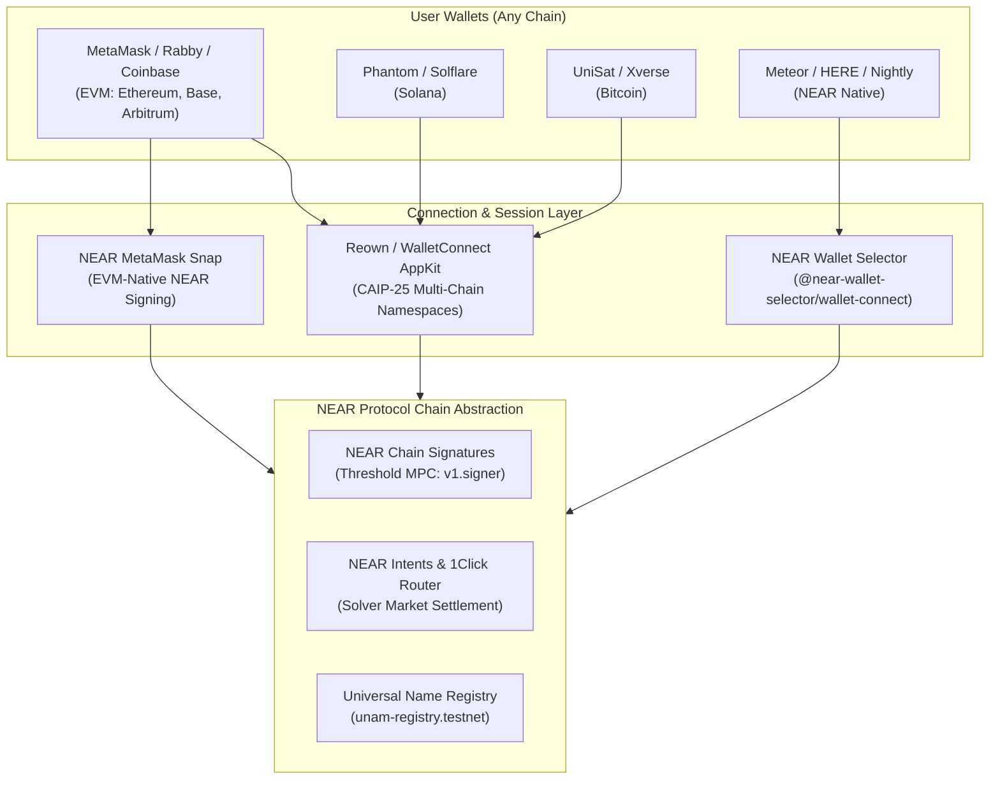
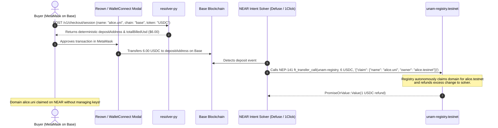

# Multichain Wallet Connectivity on NEAR: Architecture & WalletConnect Standards

This document explains how **NEAR Protocol** (`near.com`), the **NEAR Chain Abstraction** stack, and **Universal Name** (`.uni`) connect and orchestrate wallets across a wide spectrum of heterogeneous blockchains (Ethereum, Base, Solana, Bitcoin, Cosmos, and NEAR).

---

## 1. Executive Overview: The "Any Wallet, Any Chain" Paradigm

Traditional decentralized applications force users into chain-specific wallet silos: MetaMask for EVM, Phantom for Solana, Unisat for Bitcoin, and Keplr for Cosmos.

NEAR's Chain Abstraction inverts this model:
1. **Universal Connection Layer:** Senders and recipients connect with **their existing preferred wallet** on any chain.
2. **CAIP-25 Multi-Namespace Sessions:** A single WalletConnect / Reown pairing establishes simultaneous communication channels across EVM (`eip155`), Solana (`solana`), Bitcoin (`bip122`), and NEAR (`near`).
3. **Chain Signatures (MPC):** A single master key or smart contract on NEAR deterministically derives addresses and signs transactions across all external networks without wrapping tokens or relying on third-party bridge lockups.



---

## 2. The Core Connection Libraries Used by NEAR

`near.com` and ecosystem dApps leverage three primary wallet connectivity layers:

### A. Reown AppKit & WalletConnect v2/v3 (CAIP-25 Multi-Chain Namespaces)
[Reown](https://reown.com) (formerly WalletConnect Web3Modal) implements the **CAIP-25** (Chain Agnostic Authorization Management) standard. Instead of binding a connection to a single chain ID, the application requests **multi-namespace session permissions** in a single handshake:

```typescript
import { createAppKit } from '@reown/appkit';
import { mainnet, base, arbitrum, optimism, polygon, bsc, avalanche } from '@reown/appkit/networks';
import { SolanaAdapter } from '@reown/appkit-adapter-solana';
import { EthersAdapter } from '@reown/appkit-adapter-ethers';

// CAIP-25 multi-chain namespace configuration
export const appKit = createAppKit({
  adapters: [new EthersAdapter(), new SolanaAdapter()],
  networks: [mainnet, base, arbitrum, optimism, polygon, bsc, avalanche],
  metadata: {
    name: 'Universal Name (.uni)',
    description: 'One Name, Any Chain, Any Currency',
    url: 'https://uni.peni.io',
    icons: ['https://uni.peni.io/logo.png']
  },
  features: {
    email: true,
    socials: ['google', 'x', 'github', 'discord'],
    emailShowWallets: true
  }
});
```

#### CAIP-25 Handshake Details:
* **`requiredNamespaces` & `optionalNamespaces`:**
  * **`eip155`:** Encompasses all EVM chains (`eip155:1` Ethereum, `eip155:8453` Base, `eip155:42161` Arbitrum, `eip155:137` Polygon, etc.).
  * **`solana`:** Points to Solana cluster (`solana:5eykt4UsFv8P8NJdTREpY1vzqKqZKvdpKuc147dw2N9d`).
  * **`near`:** Points to NEAR networks (`near:mainnet`, `near:testnet`).
* **Session Scope:** The user approves once on mobile or desktop, and the wallet returns active addresses for all authorized namespaces simultaneously.

---

### B. NEAR Wallet Selector (`@near-wallet-selector`)
For applications built natively on NEAR, the **NEAR Wallet Selector** provides a modular modal framework supporting over 20+ wallets:

```typescript
import { setupWalletSelector } from "@near-wallet-selector/core";
import { setupModal } from "@near-wallet-selector/modal-ui";
import { setupWalletConnect } from "@near-wallet-selector/wallet-connect";
import { setupHereWallet } from "@near-wallet-selector/here-wallet";
import { setupMeteorWallet } from "@near-wallet-selector/meteor-wallet";
import { setupNightly } from "@near-wallet-selector/nightly";

const selector = await setupWalletSelector({
  network: "testnet",
  modules: [
    setupWalletConnect({
      projectId: "<REOWN_PROJECT_ID>",
      metadata: {
        name: "Universal Name Registry",
        description: "Universal Payment Registry for NEAR",
        url: "https://uni.peni.io",
        icons: ["https://uni.peni.io/icon.png"]
      },
      chainId: "near:testnet",
      methods: ["near_signIn", "near_signOut", "near_getAccounts", "near_signTransaction", "near_signTransactions"]
    }),
    setupHereWallet(),
    setupMeteorWallet(),
    setupNightly()
  ]
});

const modal = setupModal(selector, { contractId: "unam-registry.testnet" });
```

---

### C. NEAR Protocol MetaMask Snap
For Ethereum users who do not want to install a separate NEAR wallet, NEAR provides an official **MetaMask Snap**:
* **Mechanism:** MetaMask executes an isolated JavaScript plugin that derives a NEAR-compatible Ed25519 keypair directly from the user's existing MetaMask Ethereum seed phrase.
* **UX:** Users sign NEAR transactions, contract calls (`claim`, `set_record`), and intent deposits using the standard MetaMask popup window.

---

## 3. How Connected Wallets Interact with Universal Name (`.uni`)

Universal Name integrates connected wallets through three standardized operations:

### 1. Proof of Control Verification (Registration & Linking)
When a user connects their Ethereum, Solana, or Bitcoin wallet to bind an address to their `.uni` name on `unam-registry.testnet`:
1. The web client requests a signature over a domain-separated challenge:
   ```text
   Universal Name Link: peni.uni
   Chain: eip155:1
   Address: 0x71C7656EC7ab88b098defB751B7401B5f6d8976F
   Generation: 3
   Nonce: 1762732800000
   ```
2. **Signature Standards Verified by the Resolver / Registry:**
   * **EVM (`eip155`):** Standard **EIP-191** (`\x19Ethereum Signed Message:\n...`) or **EIP-712** typed data signed via MetaMask / WalletConnect.
   * **Solana (`solana`):** Standard **Ed25519** signature signed via Phantom / Solflare.
   * **Bitcoin (`bip122`):** BIP-322 signature signed via UniSat / Xverse.
3. The verified binary Interoperable Address envelope is stored on `unam-registry.testnet` using **ERC-7930**.

---

### 2. Keyless Cross-Chain Payment Checkout
Foreign-chain buyers who do not have NEAR or a NEAR wallet can purchase `.uni` domains directly using their connected wallet on Base, Ethereum, Solana, or Arbitrum:



---

## 4. Supported Blockchain Namespaces & Wallet Matrix

| Blockchain Ecosystem | CAIP-2 Namespace | Supported Wallets via WalletConnect / AppKit | Native Adapter / Integration |
| :--- | :--- | :--- | :--- |
| **Ethereum & EVM L2s** (Base, Arbitrum, Optimism, Polygon, BSC, Avalanche) | `eip155:*` | MetaMask, Rabby, Rainbow, Coinbase Wallet, Trust Wallet, OKX, Zerion | Ethers.js, Viem / Wagmi, Reown AppKit |
| **Solana** | `solana:5eykt...` | Phantom, Solflare, Backpack | `@solana/wallet-adapter`, Solana Mobile Stack |
| **Bitcoin** | `bip122:00000...` | UniSat, Xverse, Leather, OKX BTC | Bitcoin Connect, SatConnect |
| **NEAR Protocol** | `near:mainnet`, `near:testnet` | Meteor, HERE Wallet, Nightly, MyNearWallet, Ledger | `@near-wallet-selector`, NEAR MetaMask Snap |
| **Passkey / Social (Web2)** | Any supported chain | Google, Apple, X, Email Login | FastAuth, Reown Embedded Wallets |

---

## 5. Security & Multi-Chain Safety Principles

1. **Non-Custodial Multi-Chain Sessions:**  
   WalletConnect sessions use end-to-end encrypted WebSockets via the Reown Relay network. Private keys never leave the user's mobile device or hardware wallet.
2. **Domain-Separated Challenge Payloads:**  
   Address verification challenges include the domain name (`name.uni`), target chain ID (`eip155:1`), record generation counter, and expiration timestamps to prevent replay attacks across names or networks.
3. **No Hot Relayer Keys:**  
   Cross-chain settlements settle via NEP-141 callbacks (`ft_on_transfer`), ensuring domain delivery is trustless, atomic, and completely keyless.

---

## 6. Relevant Standards & Specifications

* [CAIP-2: Blockchain Identifier](https://github.com/ChainAgnostic/CAIPs/blob/master/CAIPs/caip-2.md)
* [CAIP-25: JSON-RPC Provider Authorization Management](https://github.com/ChainAgnostic/CAIPs/blob/master/CAIPs/caip-25.md)
* [ERC-7930: Interoperable Addresses](https://eips.ethereum.org/EIPS/eip-7930)
* [ENSIP-31: Payment Preferences](https://docs.ens.domains/ensip/31)
* [NEAR Chain Signatures Documentation](https://docs.near.org/chain-abstraction/chain-signatures)
